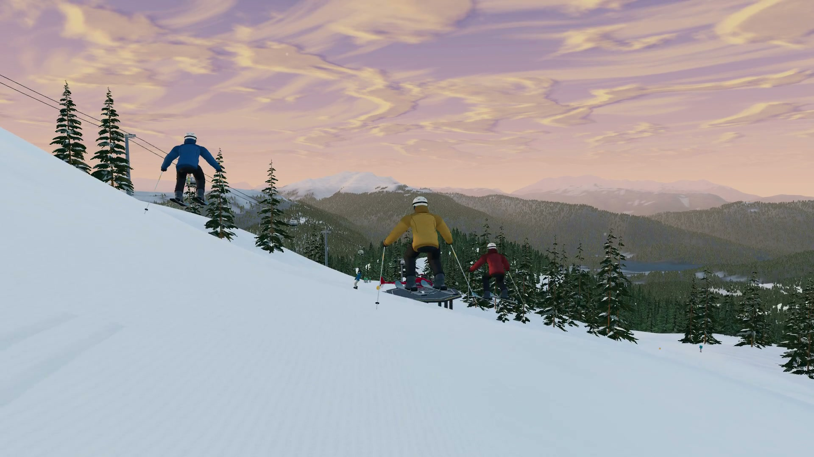

<a href="https://santiiturriaga.github.io/alpine/assets/opening.mp4"></a>

[Download the 24-second 1080p preview](assets/opening.mp4?raw=true)

# Alpine Descent

You start with your skis on, just outside the Whistler Village Gondola at Roundhouse Lodge. Push off toward Ego Bowl, walk over to the Olympic rings, or board the red PEAK 2 PEAK gondola and watch Blackcomb come into view. [Play in your browser](https://santiiturriaga.github.io/alpine/)

Open **Destinations** to browse 13 ski regions and seven summit areas. On a phone, the game opens here. Swipe between mountains or rotate a relief to see where its lifts climb. Choose Whistler to start at Roundhouse. [Browse the mountains](https://santiiturriaga.github.io/alpine/?selector)

## Your first run

Press **W** to push off, **A** and **D** to carve, and **S** to brake. At speed, **S** starts a parallel hockey stop. Hold **A** or **D** to choose the side. Hold **W** at speed to tuck, press **Space** to jump, or stop and press **B** to walk. **C** changes your view. Click the slope to swing a pole at low speed and look around with the mouse.

On a phone, steer with your left thumb and use the right-hand buttons to push, brake, or jump. You can play in portrait or rotate to either landscape orientation.

Press **M** to open the trail map. Pick a run, lift, or landmark and choose **Set destination**. Amber arrows on the snow guide you there. At a lift, **E** boards or skips the ride. Inside a gondola you can walk to the window and look down at the valley.

For company, have a friend open the same resort and drop in. You’ll join the same lobby automatically. Open **G → Multiplayer** to copy the mountain link, check the leaderboard, or switch to solo play. A wipeout resets your trick streak. Set your name and units under **Skier profile**, where you can also see your explored runs, mountains, and lifetime distance.

## Around the mountain

- Talk to Morgan at Roundhouse to start Patrol Airlift. Follow the crew to the helipad, use the compass to find each pickup, and press **E** inside the gold hover zone. Use **Copy winch seat invite** in the Mountain menu to bring a second skier. The operator can hold **W** to lower, press **E** beside the patient, and hold **S** to reel them in. The Patrol Shell doubles landing trick points while equipped.
- The mountain runs on a 20-minute day. Under **G → Conditions**, choose **Golden Hour**, **Extreme Whiteout**, or **Peak crowds**. Mapped night-skiing zones light up after dark.
- Open **G → Sled Run** to race White Fir Chute. Steer around the trees and rolling snowballs, then time your jumps off the ramps to cross the gaps.
- Open **G** for the Blackcomb Glacier cave, Springboard race, Whiskey Jack slalom, or summer biking. **L** opens the outfitter. Your gear, coins, field photos, and profile save in your browser.
- Visit the outfitter and barber in Whistler Village to try on a shell or change your hair. Traverse ski shoes cost eight mountain coins and make it easier to walk uphill through snow.
- Ride Galzigbahn at St. Anton, climb the stairs at Mont Fort, or cross the footbridge at Aiguille du Midi. Each is marked on its resort map. [Landmark photos, plans and elevation sources](data/mountains/INTERNATIONAL-LANDMARKS.md)
- At Niseko, step onto the NEST813 terrace for a view of Mount Yōtei, then ski through the birches at Grand Hirafu. At Stevens Pass, start on foot and cross US 2 from the parking lots to the lodge. [NEST813 terrace](https://santiiturriaga.github.io/alpine/?mountain=niseko-united&start=view:nest813) · [Stevens footbridge](https://santiiturriaga.github.io/alpine/?mountain=stevens-pass&start=stevens-overpass)
- Press **Esc** for graphics quality, **Realism**, and the Field Guide. Realism uses the terrain around each point to shade sheltered snow as the sun moves. Ice and gondola glass reflect the colour of the sky.

## Graphics and backcountry

On a new setup, Auto starts in **Budget** and measures frames after you enter the mountain. It tries 60, 120, and 240 FPS as the display allows, then increases detail while the measured target holds. If Budget misses 60, Auto leaves the frame rate uncapped and shows what your machine achieved. Each resort remembers its own result.

The small FPS readout under the mountain name shows the frames your browser renders. In **Esc → Graphics**, you can choose a detail level, set a frame cap, and enable edge smoothing (MSAA). Budget simplifies distant lifts, buildings, and trees while keeping nearby equipment and the shape of the mountain.

Run the [native Ego Bowl benchmark](https://santiiturriaga.github.io/alpine/?benchmark=ego-bowl) to measure a full descent with Budget graphics and a 60 FPS cap. For a lower-resolution comparison on the same computer, run the [480p benchmark](https://santiiturriaga.github.io/alpine/?benchmark=ego-bowl&resolution=480p) at the same browser window size. Both preserve your progress and settings. **Reload benchmark** starts a fresh game with the browser’s asset cache still available.

For integrated graphics, try **Budget** with **3D resolution → Adaptive · 60 FPS**. Adaptive starts at native resolution and adjusts the 3D image when the frame rate falls short. The map, text, and touch controls stay at display resolution. The graphics panel shows the actual render dimensions. Desktop defaults to **Native**, and you can also choose a fixed ceiling from 480p to 900p.

You can ski past the marked runs and keep walking or riding beyond the resort map. The surrounding mountains follow elevation surveys up to their coverage limit. Farther out, the game generates backcountry as you approach. The trail map marks where generated terrain begins.

## Run it locally

From the repository directory, start a static server and open [localhost:8080](http://localhost:8080/).

```sh
python -m http.server 8080 --bind 127.0.0.1
```

The game runs in a WebGL browser with a bundled copy of Three.js. Multiplayer uses a public MQTT broker over WebSockets. The browsers exchange temporary IDs, names, motion, and scores in resort-specific rooms. Each browser interpolates remote skiers locally. The game disconnects an idle session after five minutes. [Multiplayer service](https://www.emqx.com/en/mqtt/public-mqtt5-broker)

The trail map and the terrain you ski share the same elevation data and mapped routes. Trees, buildings, and lift machinery are modeled in code. Building interiors, trail widths, and some lift dimensions are estimates. [Geography and credits](data/README.md) · [Add a resort](data/mountains/README.md)
